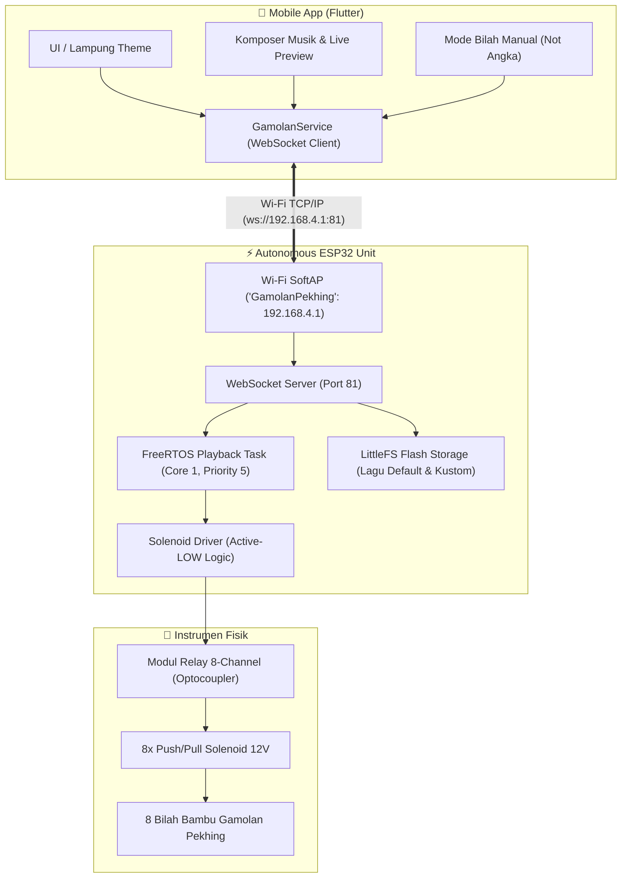

# 🎋 Gamolan Pekhing - Autonomous Robotic Musical Instrument & Mobile Controller

[](https://flutter.dev)
[](https://freertos.org)
[](https://websockets.spec.whatwg.org)
[](https://id.wikipedia.org/wiki/Gamolan_pekhing)

Sistem otomasi robotik dan kontroler cerdas alat musik tradisional khas Lampung, **Gamolan Pekhing** (sering disebut juga *Cetik*), berbasis mikrokontroler **ESP32** (FreeRTOS) dan aplikasi mobile cross-platform **Flutter**.

Sistem ini mereproduksi teknik permainan otentik Gamolan Pekhing menggunakan **dua stik mekanik solenoid** secara sinkron untuk memainkan melodi dan pola ritme ketukan (*interlocking / ostinato*), serta dilengkapi fitur penyusunan lagu kustom dengan pratinjau (*live preview*) sebelum disimpan permanen ke memori flash ESP32.

---

## 🏛️ Latar Belakang Budaya

Gamolan Pekhing adalah instrumen perkusi bambu purba asal Sekala Berak, Lampung Barat. Memiliki tangga nada pentatonis 8 bilah (*Laras Pelog Enam Nada*):
`1 (Do) · 2 (Re) · 3 (Mi) · 4 (Fa) · 5 (Sol) · 6 (La) · 7 (Si) · 8 (Do')`.

Dalam tradisi aslinya, gamolan dimainkan menggunakan dua buah stik pemukul:
- **Tangan Kanan (*Ka*)**: Memainkan kontur melodi utama.
- **Tangan Kiri (*Ki*)**: Menjaga ritme aksen atau pola ketukan konstan (*gelitak / ostinato*).

---

## 📐 Arsitektur Sistem



---

## 📂 Struktur Direktori

```text
gamolan-pekhing/
├── main/                       # Firmware ESP32 (C++ Modular / Arduino)
│   ├── main.ino                # Entry point, setup SoftAP, POST test
│   ├── config.h / config.cpp   # Konfigurasi pinout GPIO, tempo, konstanta nada
│   ├── solenoid.h / .cpp       # Abstraksi driver relay/solenoid (Active-LOW)
│   ├── storage.h / .cpp        # Manajemen file LittleFS & metadata JSON
│   ├── playback.h / .cpp       # Engine FreeRTOS real-time playback & preview
│   ├── ws_handler.h / .cpp     # WebSocket server event handler & command parser
│   └── songs.h / songs.cpp     # 20 Repertoar partitur kanonik PROGMEM (2 stik)
├── app/                        # Aplikasi Mobile Controller (Flutter)
│   ├── lib/
│   │   ├── models/             # SongModel, DefaultSongs, NoteItem
│   │   ├── screens/            # PlaylistScreen, NotAngkaScreen, ComposerScreen
│   │   ├── services/           # GamolanService (Centralized WebSocket Channel)
│   │   ├── theme/              # LampungTheme (Palet Biru & Tapis Lampung)
│   │   └── main.dart           # Inisialisasi aplikasi & navigation
│   └── test/                   # Unit & Widget Test Suite (13/13 Passed)
├── plan.md                     # Roadmap implementasi (diabaikan dari git)
├── simulator-plan.md           # Rencana simulator audio (diabaikan dari git)
└── README.md                   # Dokumentasi global proyek
```

---

## 🔌 Skema Wiring & Pinout GPIO

Peta sambungan antara pin digital ESP32 dan Modul Relay 8-Channel:

| Bilah Nada | Not Angka | Solfege | GPIO ESP32 | Modul Relay (Active-LOW) |
| :---: | :---: | :---: | :---: | :---: |
| **Bilah 1** | 1 | DO | **GPIO 26** | IN 1 |
| **Bilah 2** | 2 | RE | **GPIO 25** | IN 2 |
| **Bilah 3** | 3 | MI | **GPIO 19** | IN 3 |
| **Bilah 4** | 4 | FA | **GPIO 18** | IN 4 |
| **Bilah 5** | 5 | SOL | **GPIO 17** | IN 5 |
| **Bilah 6** | 6 | LA | **GPIO 16** | IN 6 |
| **Bilah 7** | 7 | SI | **GPIO 14** | IN 7 |
| **Bilah 8** | 8 | DO' (Tinggi) | **GPIO 13** | IN 8 |

> [!IMPORTANT]
> **Pedoman Catu Daya (Power Supply):**
> - **ESP32**: 5V DC (via port USB atau buck converter step-down).
> - **Solenoid**: Wajib menggunakan adaptor terpisah **12V DC minimal 3A - 5A**.
> - **Common Ground**: Hubungkan ground (GND) ESP32 ke ground modul relay/solenoid.
> - **Proteksi Flyback**: Pasang dioda **1N4007** secara paralel-terbalik di setiap kutub koil solenoid untuk mencegah lonjakan tegangan balik (*back-EMF*) yang dapat merusak mikrokontroler.

---

## 🎵 Repertoar Lagu (20 Lagu Bawaan)

Firmware dilengkapi 20 lagu terkurasi yang disimpan langsung di memori flash ESP32:

### 1. Tabuh Tradisional Lampung (Gamolan Pekhing Asli - 2 Stik)
Ditranskripsi secara matematis dari notasi akademik Maestro Syapril Yamin & Muhammad Yoga Saputra (*16 unit per birama 4/4 presisi*):
1. **Tabuh Sambai Agung** (Sekala Berak, 100 BPM, Ostinato Tangan Kiri di Bilah 1 `| - - 1 - | 1 - 1 1 |`).
2. **Tabuh Sekeli** (100 BPM, Ritem Tangan Kiri di Bilah 2 beralih ke Bilah 1).
3. **Tabuh Jakhang** (Tempo Lambat 66 BPM, Interlocking ketuk rapat `| - 1 - - |`).
4. **Tabuh Tari** (76 BPM, Melodi tari tunggal tangan kanan & transisi interlocking bagian 5 3).
5. **Tabuh Alau-Alau Kembahang** (Tempo Cepat 132 BPM, Sinkopasi ritmis lincah).

### 2. Lagu Nasional Indonesia
- Indonesia Raya
- Tanah Airku
- Bagimu Negeri
- Garuda Pancasila
- Ibu Kita Kartini

### 3. Lagu Daerah Nusantara
- Anak Kambing Saya
- Cublak-Cublak Suweng
- Gundul-Gundul Pacul
- Apuse
- Suwe Ora Jamu

### 4. Lagu Anak & Populer
- Twinkle Twinkle Little Star
- Selamat Ulang Tahun
- Pelangi-Pelangi
- Balonku Ada Lima
- Naik Delman

---

## ✨ Fitur Utama

- **Teknik 2 Stik Bersamaan (`duo(kanan, kiri)`)**: Struktur nibble C++ efisien (4-bit kanan, 4-bit kiri) memungkinkan kedua stik memukul bilah yang berbeda secara serentak.
- **Pratinjau Suara Sebelum Simpan (*Live Preview*)**: Pengguna dapat mendengarkan lagu ciptaannya langsung di alat fisik tanpa perlu menyimpannya terlebih dahulu ke flash, mencegah keausan flash memory (*zero flash-wear*).
- **Kursor Not Real-Time**: Daftar not bergeser otomatis dan not yang sedang berbunyi disorot tebal di layar HP.
- **Mode Bilah Manual (*Virtual Keyboard*)**: Mainkan 8 bilah gamolan langsung dari layar HP dengan latensi rendah melalui WebSocket.
- **Power-On Self Test (POST)**: Setiap kali ESP32 dinyalakan, alat otomatis menguji tangga nada 1 sampai 8 secara berurutan.

---

## 🚀 Panduan Memulai

### 1. Upload Firmware ke ESP32

#### Menggunakan Arduino IDE:
1. Buka folder [`main/`](file:///D:/Documents/Arduino/gamolan-pekhing/main) di Arduino IDE.
2. Pasang library: `WebSocketsServer` oleh Markus Sattler dan `ArduinoJson` (v7).
3. Pilih board **ESP32 Dev Module** dan tentukan port COM yang sesuai.
4. Klik **Upload**.

#### Menggunakan Arduino CLI:
```powershell
& 'C:\aplikasi\Arduino IDE\resources\app\lib\backend\resources\arduino-cli.exe' compile --fqbn esp32:esp32:esp32 main
& 'C:\aplikasi\Arduino IDE\resources\app\lib\backend\resources\arduino-cli.exe' upload -p COMx --fqbn esp32:esp32:esp32 main
```

---

### 2. Menjalankan & Build Aplikasi Flutter

Pastikan Flutter SDK (>= 3.13) telah terpasang di sistem.

Masuk ke folder `app`:
```bash
cd app
```

#### Menjalankan Test Otomatis:
```bash
flutter test
flutter analyze
```

#### Menjalankan Langsung ke HP Android:
Hubungkan HP dengan kabel USB dan aktifkan *USB Debugging*:
```bash
flutter run
```

#### Build File APK Android:
```bash
# Debug APK (siap install cepat tanpa signing)
flutter build apk --debug

# Output file: app/build/app/outputs/flutter-apk/app-debug.apk
```

---

## 📡 Spesifikasi Protokol WebSocket

Komunikasi antara HP dan ESP32 berjalan di port `81` melalui pesan JSON:

| Perintah (`cmd`) | Parameter | Fungsi |
| :--- | :--- | :--- |
| `list` | - | Mengambil seluruh daftar lagu dari memori ESP32 |
| `play` | `{"id": <int>}` | Memulai pemutaran lagu berdasarkan ID |
| `stop` | - | Menghentikan pemutaran lagu yang sedang berjalan |
| `hit` | `{"n": <1-8>}` | Memukul satu bilah nada secara instan (Mode Manual) |
| `preview` | `{"tempo": <int>, "notes": [[nada, panjang], ...]}` | Memutar pratinjau rangkaian nada tanpa menyimpannya ke flash |
| `add` | `{"name": "...", "tempo": <int>, "cat": "...", "notes": [...]}` | Menyimpan lagu kustom baru ke flash LittleFS |
| `edit` | `{"id": <int>, "name": "...", "tempo": <int>, ...}` | Memperbarui lagu kustom di LittleFS |
| `del` | `{"id": <int>}` | Menghapus lagu kustom dari flash |
| `reset_defaults` | - | Memulihkan seluruh lagu bawaan pabrik |

---

## 📜 Lisensi & Kontribusi

Proyek ini dikembangkan untuk pelestarian budaya tradisional Lampung berbasis teknologi otomasi modern. Terbuka untuk riset, edukasi, dan pengembangan seni pertunjukan karawitan digital.
